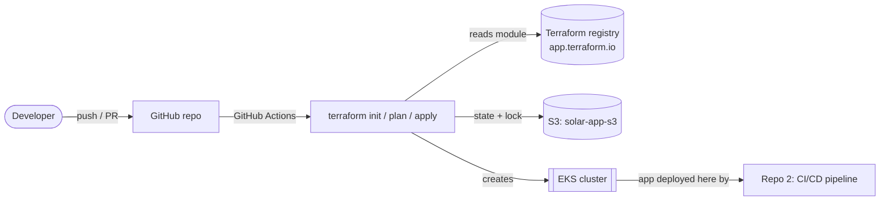

# Solar System App: AWS Infrastructure

Terraform code that builds the AWS platform for the Solar System application: a **Kubernetes cluster on Amazon EKS**, with Terraform state stored safely in **S3**.

This is **repo 1 of 2**. The application and its CI/CD pipeline live in the sister repo:
[`Automated-CI-CD-pipeline-for-solar-system-application`](https://github.com/HTI-Graduation-Project/Automated-CI-CD-pipeline-for-solar-system-application).

> Infrastructure first, application second. This repo must run before the app can be deployed.

---

## What this repo does

- Calls a reusable Terraform module (`solar-app-eks-module`) that creates the EKS cluster.
- Stores the Terraform state file remotely in an S3 bucket, so the team shares one source of truth.
- Uses a lock file on S3, so two people cannot change the infrastructure at the same time.
- Runs automatically through GitHub Actions (see `.github/workflows`).



---

## Repository structure

```
solar-system-application-aws-infrastructure/
├── .github/workflows/     # GitHub Actions workflows for Terraform
├── solar-app-module/      # Terraform module code for the solar app platform
├── main.tf                # Root config: calls the EKS module + S3 backend
└── .gitignore
```

### The root `main.tf`

```hcl
module "solar-app-eks-module" {
  source  = "app.terraform.io/HTI-graduation-project/solar-app-eks-module/adelelnimr"
  version = "1.0.1"
}

terraform {
  backend "s3" {
    bucket       = "solar-app-s3"
    key          = "state_file/terraform.tfstate"
    region       = "us-east-1"
    use_lockfile = true
  }
}
```

In plain words:

| Block | Meaning |
|---|---|
| `module "solar-app-eks-module"` | Pull the EKS module (version `1.0.1`) from the private Terraform registry and build the cluster from it |
| `backend "s3"` | Keep the state file in bucket `solar-app-s3`, at `state_file/terraform.tfstate`, in `us-east-1` |
| `use_lockfile = true` | Use S3's own locking (no DynamoDB table needed). Requires Terraform 1.10+ |

---

## Prerequisites

| Tool | Why | Check |
|---|---|---|
| AWS account + IAM user/role | Create EKS and use S3 | `aws sts get-caller-identity` |
| AWS CLI v2 | Authenticate and get kubeconfig | `aws --version` |
| Terraform 1.10 or newer | `use_lockfile` support | `terraform version` |
| Terraform registry access | The module is pulled from `app.terraform.io` | `terraform login` |
| kubectl | Talk to the cluster after it exists | `kubectl version --client` |
| The S3 bucket `solar-app-s3` | Backend must exist **before** `terraform init` | `aws s3 ls s3://solar-app-s3` |

---

## How to start (manual run)

### 1. Clone

```bash
git clone https://github.com/HTI-Graduation-Project/solar-system-application-aws-infrastructure.git
cd solar-system-application-aws-infrastructure
```

### 2. Authenticate

```bash
aws configure                 # access key, secret, default region us-east-1
terraform login               # opens a browser to create a token for app.terraform.io
```

### 3. Make sure the state bucket exists

```bash
aws s3 ls s3://solar-app-s3 || aws s3 mb s3://solar-app-s3 --region us-east-1
aws s3api put-bucket-versioning --bucket solar-app-s3 \
  --versioning-configuration Status=Enabled      # recommended, lets you recover old state
```

### 4. Initialize, plan, apply

```bash
terraform init
terraform validate
terraform plan -out=tfplan
terraform apply tfplan
```

EKS usually takes 10 to 15 minutes to create.

### 5. Connect to the cluster

```bash
aws eks update-kubeconfig --region us-east-1 --name <cluster-name>
kubectl get nodes
```

Use the cluster name defined in the module (check `terraform output` or the module code in `solar-app-module/`). When the nodes show `Ready`, hand over to the app repo.

---

## Running through GitHub Actions

The workflows in `.github/workflows/` automate the same commands. Check the workflow files for exact triggers and fill this table in for your team:

| Item | Value |
|---|---|
| Trigger (push / PR / manual) | _fill in from the workflow file_ |
| Required GitHub secrets | _usually AWS access key and secret, plus a Terraform registry token_ |
| Who approves `apply` | _fill in_ |

---

## How this repo connects to the app repo

- This repo **creates** the EKS cluster.
- The app repo **deploys into** that cluster using the manifests in its `kubernetes/` folder, and its pipeline needs access to the same cluster.
- Both repos must use the same AWS account and region (`us-east-1` for the state backend).
- Details for the app side: see the app repo README (`cicd-app/README.md` in this bundle).

---

## Destroy (clean up to stop AWS costs)

```bash
# first remove what the app created inside the cluster (load balancers, volumes)
terraform destroy
```

EKS and its nodes cost money while they run. Always destroy lab environments when you finish.

---

## Troubleshooting

| Problem | Likely cause | Fix |
|---|---|---|
| `Failed to query available provider packages` or module download error | Not logged in to the registry | Run `terraform login` |
| `NoSuchBucket` on init | Backend bucket missing | Create `solar-app-s3` first (step 3) |
| `Error acquiring the state lock` | A previous run crashed | Check nobody else is running, then `terraform force-unlock <ID>` |
| `Unsupported argument use_lockfile` | Terraform too old | Upgrade to 1.10+ |
| `kubectl` cannot connect | Wrong kubeconfig or region | Re-run `aws eks update-kubeconfig` with the right name and region |
| `AccessDenied` | IAM user lacks EKS/S3 permissions | Attach the needed policies |

---

## Security notes

- Never commit `terraform.tfstate`, `.tfvars` with secrets, or AWS keys. Keep them in `.gitignore`.
- Turn on S3 bucket versioning and encryption for the state bucket, and block public access.
- Use least-privilege IAM roles for the pipeline.
